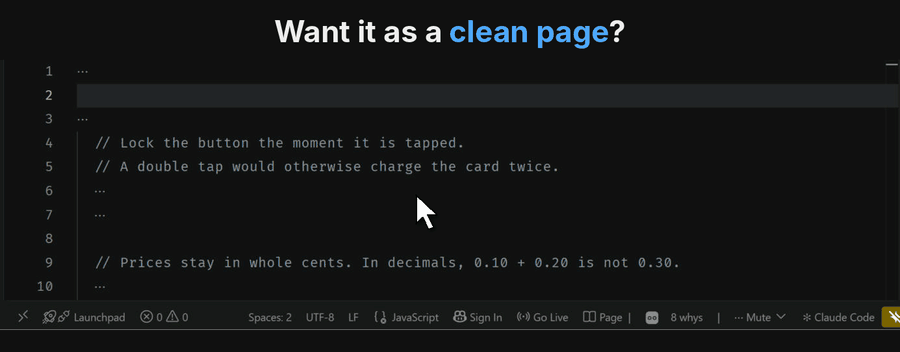
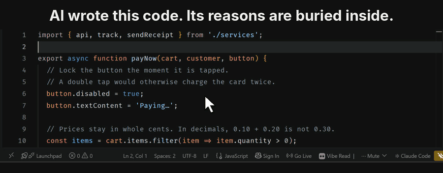
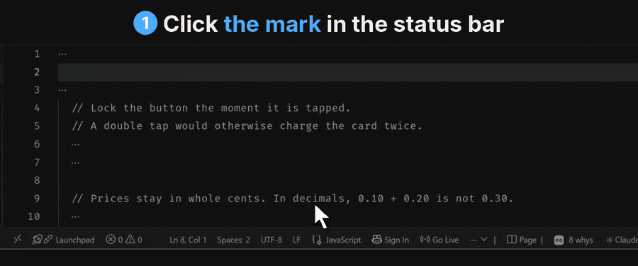
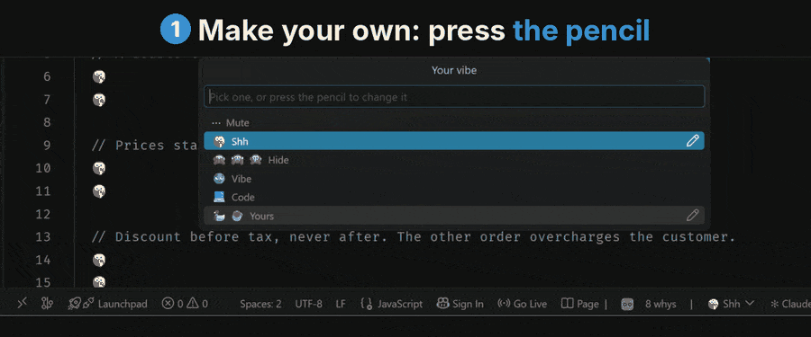
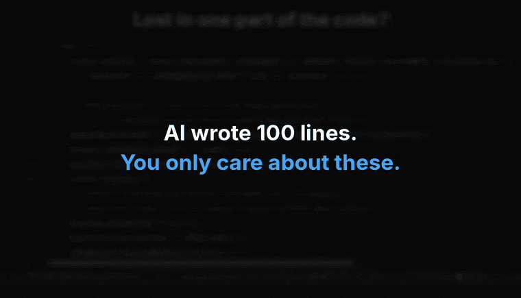

| | |
|---|---|
| <kbd>Alt</kbd> <kbd>X</kbd>  🖱️&nbsp;**📖&nbsp;Read** |  |

**Read your AI's code like a book.** Every reason it wrote, numbered on one calm page — then save it as notes, a Markdown file next to your code.

| | |
|---|---|
| <kbd>Alt</kbd> <kbd>M</kbd>  🖱️&nbsp;**Hide** |  |

**Or stay in the code.** Hide it right in the editor — only the reasons stay. Click Show and it is back, untouched.

| | |
|---|---|
| 🦆 🤫 🙈  **Vibe** |  |

**Pick a mood for the hidden code.** Same code, a different vibe.

| | |
|---|---|
| ✏️  **Change&nbsp;vibe** |  |

**Make it yours.** Type any emoji or word, and the hidden code changes as you type.

---

## Code is for the machine. Comments are for you.

Your AI explains every decision it makes, in the comments. You never read them, because they are buried in the code. Vibe Read sets them out on one calm page, so you finally do — and your next instruction to the AI is a sharper one.

| | |
|---|---|
| 🖱️&nbsp;**📖&nbsp;Read** · <kbd>Alt</kbd>&nbsp;<kbd>X</kbd> | The whole file's reasoning on one page, every why numbered, its code folded under it. **Save as notes** keeps it as a Markdown file for GitHub, Obsidian or Notion. |
| 🖱️&nbsp;**Hide** · <kbd>Alt</kbd>&nbsp;<kbd>M</kbd> | The code hides right in the editor. Only the comments stay. Click **Show** and it is back exactly as it was — nothing is edited. |
| Select&nbsp;lines · <kbd>Alt</kbd>&nbsp;<kbd>M</kbd> | Hides or shows only those lines. |
| <kbd>Ctrl</kbd>&nbsp;<kbd>C</kbd> | While the code is hidden, copies only what you see. The rest of the time it is VS Code's own copy. |
| ✏️&nbsp;**Vibe** | The mark where the code was: 🦆 ☕ Duck, ⋯ Quiet, 🤫 Shh, 🤷‍♂️ 🤦‍♀️ Oops, 🙈 🙉 🙊 Wise — or your own, with the pencil. |

| | |
|---|---|
| Select  <kbd>Alt</kbd> <kbd>M</kbd>  <kbd>Ctrl</kbd> <kbd>C</kbd> |  |

**Just the lines you choose.** Select a part, hide its code, copy only its reasons — and paste them to your AI.

The page counts the comments as **whys**: *8 whys* means the file explains eight things. A low number means the AI barely explained itself — ask it for better comments next time.

Can't see a button? Right-click the status bar and tick **Vibe Read: Read**, **Hide** or **Your vibe**. <kbd>Alt</kbd> <kbd>X</kbd> and <kbd>Alt</kbd> <kbd>M</kbd> always work.

## How to use it with your AI

1. **Ask for reasons.** *"Write this function, and comment your reasoning."* That second half costs nothing and is the whole reason this works.
2. **Press 📖 Read.** Every reason on one page. Thirty seconds of reading.
3. **Ask better.** Not *"fix the checkout"*, but *"keep the discount before tax, round only at the end."* A sentence you could not have written a minute ago.
4. **Save as notes.** What you understood is kept.

Then round again. Each turn you understand a little more, and the AI guesses a little less.

## Any language

Python, JavaScript, TypeScript, JSX/TSX, Java, C, C++, C#, Go, Rust, Ruby, PHP, Swift, Kotlin, Scala, Dart, SQL, HTML, XML, Vue, Svelte, CSS, YAML, TOML, shell, PowerShell, Dockerfile, Makefile, Lua, Haskell, Clojure, LaTeX, MATLAB, R, Perl, Elixir and more.

Comments at the end of a line and Python docstrings count as reasons too.

## Why I built this

I stopped writing most of my code and started describing it instead. The AI explained itself carefully every single time — and I ignored every word, accepted code I had not understood, then wondered why my prompts were not working.

The explanation and the code live in the same file, and the code always wins your attention. So this does one thing: it puts what your AI told you on a page of its own, so you can actually read it.

---

*Made by [Naveed](https://github.com/naveed-toro). MIT licensed. Issues and ideas welcome at [github.com/naveed-toro/vibe-read](https://github.com/naveed-toro/vibe-read).*
